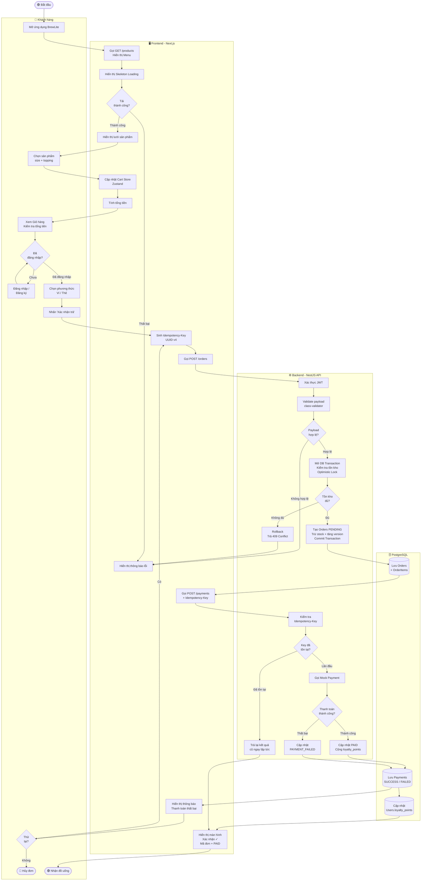

# Activity Diagram — Luồng Đặt và Thanh toán (End-to-End)

> **Use-Case:** UC-07 — Checkout  
> **Công cụ:** Mermaid  
> **Cập nhật:** 2026-10-18

## Sơ đồ

## Ghi chú

| Màu / Ký hiệu | Ý nghĩa |
|---|---|
| 🟢 Bắt đầu / Kết thúc thành công | Happy path |
| 🔴 Kết thúc thất bại | Exception path |
| Hình thoi `{...}` | Điểm quyết định (Decision node) |
| Swimlane `USER` | Các hành động do khách hàng thực hiện |
| Swimlane `FRONTEND` | Xử lý tại trình duyệt / Next.js |
| Swimlane `BACKEND` | Xử lý tại NestJS API |
| Swimlane `DB` | Thao tác với PostgreSQL |

## Các nhánh Ngoại lệ được thể hiện

1. **API lỗi khi tải menu** → Hiển thị thông báo lỗi, không crash app.
2. **Chưa đăng nhập** → Chuyển hướng đăng nhập, giữ nguyên giỏ hàng.
3. **Payload không hợp lệ** → Trả 400, hiển thị lỗi cụ thể.
4. **Hết hàng (Optimistic Lock thất bại)** → Rollback, trả 409 Conflict.
5. **Thanh toán thất bại** → PAYMENT_FAILED, cho phép retry với key mới.
6. **Retry trùng lặp (same Idempotency-Key)** → Trả kết quả cũ, không xử lý lại.
