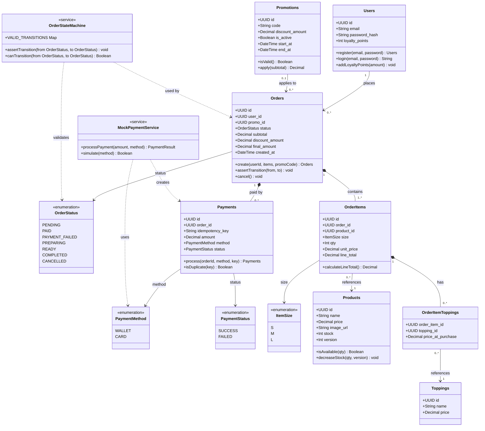

# Class Diagram — Domain Model BrewLite

> **Mức độ:** Domain / Business Layer  
> **Công cụ:** Mermaid  
> **Căn cứ:** `apps/api/prisma/schema.prisma`  
> **Cập nhật:** 2026-10-18

## Sơ đồ

## Mô tả Chi tiết các Lớp

### Lớp nghiệp vụ (Entity Classes)

| Lớp | Vai trò | Ghi chú quan trọng |
|---|---|---|
| `Users` | Tài khoản người dùng | `password_hash` không bao giờ trả về qua API; `loyalty_points` cộng tự động khi đơn PAID |
| `Products` | Sản phẩm trong menu | Cột `version` dùng cho Optimistic Locking; `stock` không bao giờ âm |
| `Toppings` | Topping có thể thêm vào món | Giá topping lưu snapshot tại thời điểm đặt trong `OrderItemToppings.price_at_purchase` |
| `Promotions` | Mã khuyến mãi | Kiểm tra `is_active` + khoảng thời gian `start_at..end_at` trước khi áp dụng |
| `Orders` | Đơn hàng | Trạng thái chuyển đổi được kiểm soát bởi `OrderStateMachine` |
| `OrderItems` | Dòng sản phẩm trong đơn | Lưu `unit_price` snapshot để bảo toàn giá khi giá sản phẩm thay đổi sau |
| `OrderItemToppings` | Topping đã chọn trong dòng món | Composite PK `(order_item_id, topping_id)` |
| `Payments` | Bản ghi thanh toán | `idempotency_key` là UNIQUE — chống thanh toán trùng |

### Lớp Dịch vụ (Service Classes)

| Lớp | Vai trò | Phương thức chính |
|---|---|---|
| `OrderStateMachine` | Kiểm soát chuyển trạng thái đơn hàng | `assertTransition(from, to)` — ném Exception nếu chuyển trạng thái không hợp lệ |
| `MockPaymentService` | Giả lập cổng thanh toán | `processPayment(amount, method)` — trả về `{ success: boolean }` |

## Bảng Quan hệ

| Quan hệ | Kiểu | Mô tả |
|---|---|---|
| `Users` → `Orders` | 1 — 0..* | Một user có thể có nhiều đơn |
| `Orders` → `OrderItems` | 1 — 1..* | Một đơn phải có ít nhất 1 dòng món |
| `OrderItems` → `Products` | \*..1 | Nhiều dòng món có thể tham chiếu cùng 1 sản phẩm |
| `OrderItems` → `OrderItemToppings` | 1 — 0..* | Một dòng món có thể không có hoặc có nhiều topping |
| `OrderItemToppings` → `Toppings` | \*..1 | Nhiều lựa chọn topping tham chiếu cùng 1 Topping |
| `Orders` → `Payments` | 1 — 0..* | Một đơn có thể có nhiều lần thử thanh toán |
| `Promotions` → `Orders` | 0..1 — 0..* | Một đơn có thể áp 0 hoặc 1 mã giảm giá |
