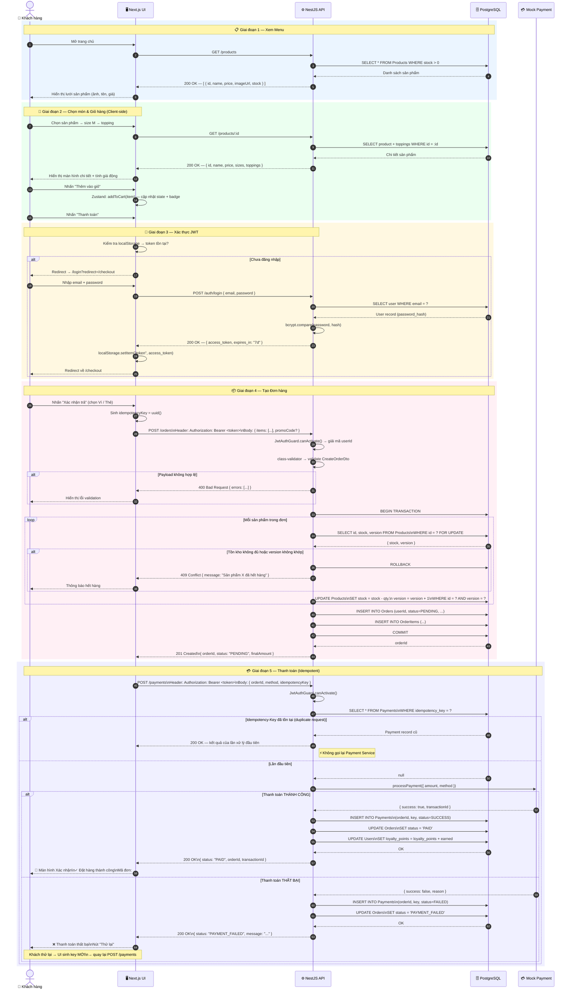

# Sequence Diagram — Đặt và Thanh toán Đơn hàng

> **Use-Case:** UC-07 — Checkout  
> **Công cụ:** Mermaid  
> **Cập nhật:** 2026-10-18

## Sơ đồ

## Ghi chú Kỹ thuật

| # | Điểm kỹ thuật | Vị trí trong sơ đồ |
|---|---|---|
| 1 | **JWT Auth Guard** | Bước 14, 28 — mọi route có dữ liệu nhạy cảm đều xác thực token |
| 2 | **class-validator** | Bước 16 — validate DTO trước khi xử lý business logic |
| 3 | **Database Transaction** | Bước 18–26 — BEGIN → UPDATE stock → INSERT Order → COMMIT/ROLLBACK |
| 4 | **Optimistic Locking** | Bước 21 — `WHERE id = ? AND version = ?` chống race condition |
| 5 | **Idempotency-Key** | Bước 30–32 — kiểm tra key trước khi gọi Payment, trả lại kết quả cũ nếu trùng |
| 6 | **Loyalty Points** | Bước 38 — cộng điểm ngay khi đơn chuyển sang PAID |
| 7 | **State Machine** | Bước 37, 43 — `assertTransition(PENDING, PAID)` và `assertTransition(PENDING, PAYMENT_FAILED)` |
